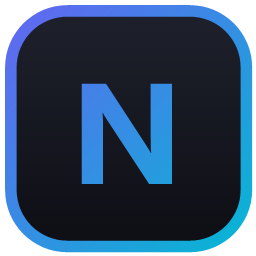
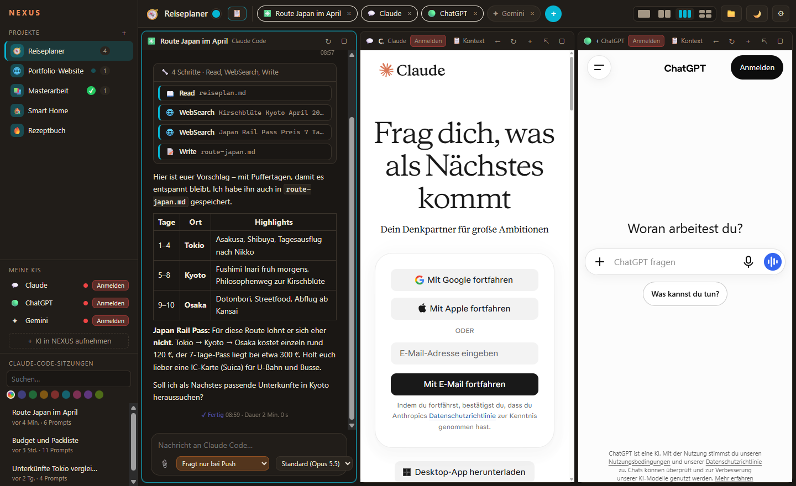
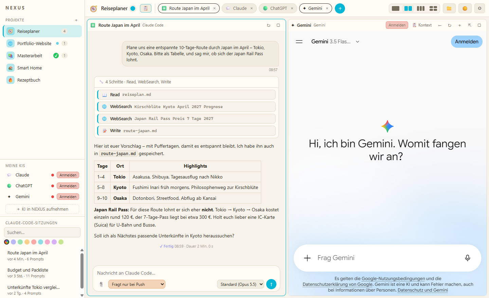
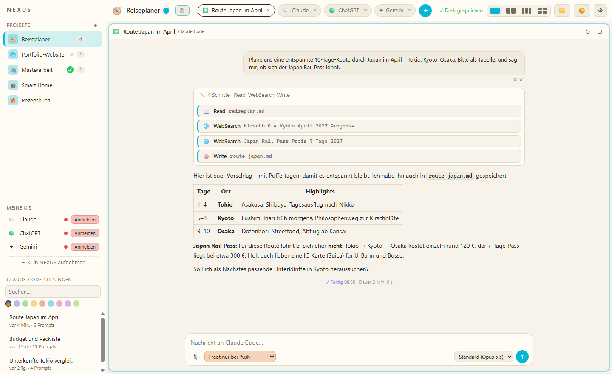
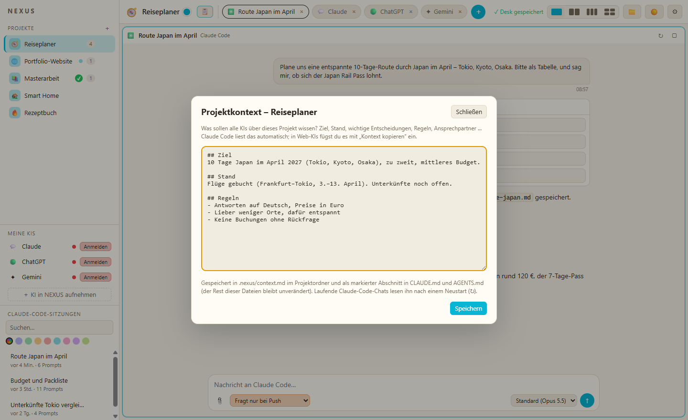
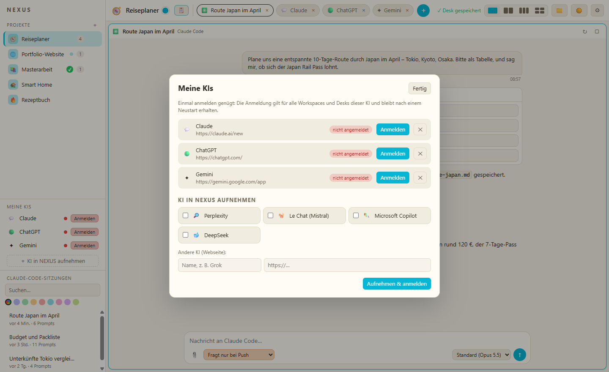
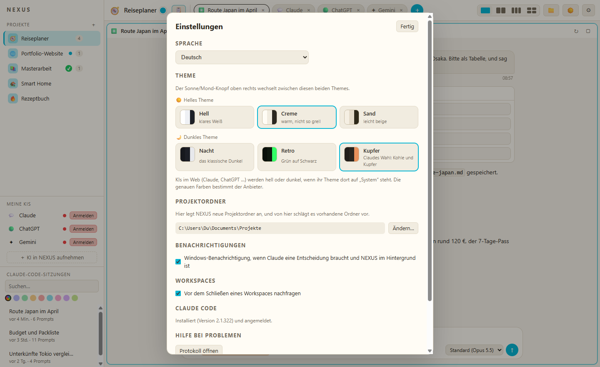

<p align="center">
  
</p>

<h1 align="center">NEXUS</h1>

<p align="center"><strong>Alle deine KIs an einem Ort – sortiert nach Projekten.</strong><br>
<em>Your AI. Your Workspace. Your Way.</em></p>

<p align="center">
  <a href="https://github.com/CaseyMazey/NEXUS/releases/latest/download/NEXUS-Setup.exe"></a>
</p>

<p align="center">
  <a href="https://github.com/CaseyMazey/NEXUS/releases/latest"></a>
  
  
  <a href="LICENSE"></a>
</p>

<p align="center">
  
</p>

Du nutzt Claude, ChatGPT, Gemini und Claude Code, und jedes läuft in einem eigenen Fenster oder Tab? **NEXUS bringt alles an einen Ort.**

Links stehen deine Projekte. Jedes Projekt hat einen eigenen **Desk**: einen Schreibtisch, auf dem bis zu vier KIs nebeneinander liegen. Wechselst du das Projekt, wechselt der ganze Desk mit, und jede KI macht genau dort weiter, wo du aufgehört hast.

- 🔒 **Ohne Konto, ohne Server.** NEXUS läuft komplett auf deinem Rechner.
- 🔑 **Deine Anmeldungen bleiben bei dir.** Du meldest dich bei deinen KIs selbst an. NEXUS speichert keine Zugangsdaten.
- 🔄 **Aktualisiert sich selbst.** Neue Versionen kommen automatisch.

## Installieren

1. **[NEXUS-Setup.exe herunterladen](https://github.com/CaseyMazey/NEXUS/releases/latest/download/NEXUS-Setup.exe)** (Windows 10/11, ca. 120 MB).
2. Die Datei ausführen. NEXUS installiert sich für deinen Benutzer, ohne Admin-Rechte, und legt eine Verknüpfung auf dem Desktop und im Startmenü an.
3. Erscheint „Der Computer wurde durch Windows geschützt“: auf **Weitere Informationen → Trotzdem ausführen** klicken. Die Meldung kommt, weil das Setup noch nicht signiert ist.

Deinstallieren geht über Windows-Einstellungen → Apps. Deine Daten bleiben dabei erhalten.

## So sieht NEXUS aus

### Projekte und Desks

Jedes Projekt bekommt einen eigenen Desk. Darauf liegen bis zu vier KIs nebeneinander: Claude Code, Claude, ChatGPT, Gemini oder jede andere KI-Webseite. Die Zeichen an den Projektnamen zeigen, was gerade passiert:

- **pulsierender Punkt:** Claude arbeitet noch
- **!**: Claude wartet auf deine Entscheidung
- **✓**: Claude ist fertig, und du hast es noch nicht angesehen

<p align="center"></p>

### 3C – Claude Code mit eigener Chat-Oberfläche

[Claude Code](https://claude.com/claude-code) bekommt in NEXUS ein Chatfenster statt des Terminals:
- Werkzeug-Schritte erscheinen als aufklappbare Karten.
- Zu jeder Nachricht stehen Uhrzeit und Dauer.
- Du kannst weiterschreiben, während Claude arbeitet.
- Vorschläge für die nächste Nachricht übernimmst du mit Tab.
- 📎 Clippy hängt Dateien jeder Art an: Bilder, PDFs, Word, Excel und mehr.

Beim Rechte-Modus wählst du, wie viel Claude selbst entscheiden darf:
- **Manuell:** fragt vor allem
- **Änderungen automatisch:** ändert Dateien ohne Rückfrage
- **Auto:** fragt nur bei riskanten Schritten
- **Fragt nur bei Push:** fragt nur vor `git push`
- **Nie fragen:** fragt gar nicht

Braucht Claude eine Entscheidung, während NEXUS im Hintergrund ist, meldet sich Windows unten rechts.

<p align="center"></p>

### Projektkontext – ein Wissen für alle KIs

Halte pro Projekt fest, was alle KIs wissen sollen, also Ziel, Stand und Regeln:
- **Claude Code** liest den Kontext automatisch. NEXUS legt ihn als Abschnitt in `CLAUDE.md` und `AGENTS.md` im Projektordner ab.
- **Claude, ChatGPT und Gemini im Web** bekommen ihn per Knopf **📋 Kontext**: Er landet in der Zwischenablage, und du fügst ihn mit Strg+V ein.

<p align="center"></p>

### Meine KIs

Claude, ChatGPT, Gemini, Perplexity, Le Chat, Copilot, DeepSeek oder jede andere KI-Webseite: **einmal anmelden**, und die Anmeldung gilt in allen Desks und übersteht Neustarts.

<p align="center"></p>

### Einstellungen und Themes

- **Sechs Themes:** Hell, Creme, Sand, Nacht, Retro und Kupfer. Der Sonne/Mond-Knopf wechselt zwischen deinem hellen und deinem dunklen Theme.
- **Sprache:** Deutsch oder Englisch.
- **Hilfe:** Über „Protokoll öffnen“ kommst du an das Protokoll, falls einmal etwas nicht klappt.

<p align="center"></p>

<sub>Die Bilder zeigen Beispielprojekte. Das Gespräch im Chat ist ein Beispiel, und die Web-KIs sind nicht angemeldet.</sub>

## Gut zu wissen

- **Claude Code:** Für 3C und das Terminal brauchst du [Claude Code](https://claude.com/claude-code) auf deinem Rechner, angemeldet mit deinem eigenen Konto. Fehlt es, sagt NEXUS dir, was zu tun ist.
- **Deine Daten:** Alles liegt bei dir in `%APPDATA%\NEXUS`. Sicherungen der letzten 7 Tage liegen in `backups\`, das Protokoll in `logs\`. Das Protokoll enthält keine Zugangsdaten und keine E-Mail-Adressen.
- **Die KI-Webseiten** laufen unverändert und getrennt voneinander. NEXUS schleust keine Skripte ein und liest keine Chats aus.

## Für Entwickler

Der Code der App liegt in [`app/`](app/README.md) (Electron).

```bash
cd app
npm install
npm start              # aus dem Quellcode starten
npm test               # Unit- und Oberflächentests
npm run screenshots    # Bilder für diese README neu erzeugen (mit Demo-Daten)
npm run dist           # Setup bauen
```

- [`docs/phase-1/plan.md`](docs/phase-1/plan.md): Plan und Stand der Meilensteine
- [`docs/phase-0/ergebnisse.md`](docs/phase-0/ergebnisse.md): technische Validierung
- [`spike/`](spike): Prototypen aus Phase 0 (Archiv)

---

### English

NEXUS puts **all your AIs in one place, organised by project**. Every project gets its own desk with up to four AIs side by side: Claude Code (with its own chat UI, “3C”), Claude, ChatGPT, Gemini and more. A shared **project context** keeps every AI on the same page. There is no NEXUS account and no server. You connect your own AIs and sign in to them yourself.

**[Download NEXUS-Setup.exe](https://github.com/CaseyMazey/NEXUS/releases/latest/download/NEXUS-Setup.exe)**, run it (no admin rights needed), and NEXUS keeps itself up to date. If Windows SmartScreen warns on first start, click **More info → Run anyway**: the installer is not signed yet. The app speaks English and German.

## Lizenz

[MIT](LICENSE) © CaseyMazey
